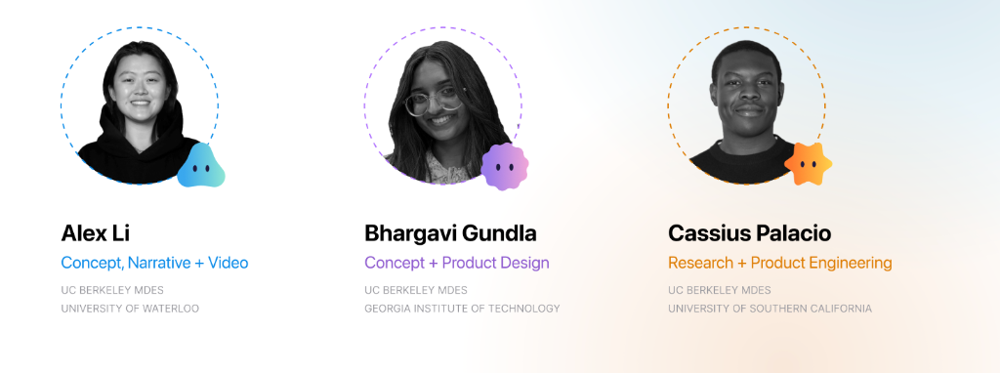
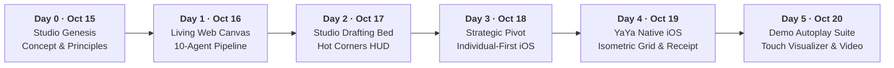

# SVSD Winners: YaYa

Team ABC's entry for the Silicon Valley School of Design (SVSD) design competition: **"The Search for Top Young Design Talent."**

- **Deliverables:** Camera-ready native iOS product prototype ([YaYa iOS](file:///Users/cassiuspalacio/Documents/SVSD/BranchiOS)) and a 7-minute submission video.
- **Deadline:** Monday, October 19, 2026 at 11:59 PM Pacific. Finalists announced October 22. Finals in NYC on November 6–8.
- **Native iOS Prototype:** [YaYa.xcodeproj](file:///Users/cassiuspalacio/Documents/SVSD/BranchiOS/YaYa.xcodeproj) (Scheme: `YaYa`)

---

## The Team (Team ABC)



UC Berkeley Master of Design (MDes) candidates combining product engineering, systems design, narrative strategy, and design research:

| Teammate | Studio Role & Focus | Background | Thinker Archetype |
|---|---|---|---|
| **Cassius Palacio** ([@cassiusp-beep](https://github.com/cassiusp-beep)) | **Research + Product Engineering**<br>Autonomous agent pipeline, iOS engineering, spatial interaction math, demo recording infrastructure | **UC Berkeley MDes**<br>University of Southern California | **Spark** *(Strategy & Emergence)*<br>Hex: `#FFB547` / `#5E8A56` |
| **Bhargavi Gundla** ([@berkeley-bhargs](https://github.com/berkeley-bhargs)) | **Concept + Product Design**<br>Individual-first onboarding, screen architecture, studio visual design, physical receipts | **UC Berkeley MDes**<br>Georgia Institute of Technology | **Bloom** *(Systems & Structures)*<br>Hex: `#E39A57` / `#C9652F` |
| **Alex Li** ([@al3xxli](https://github.com/al3xxli)) | **Concept, Narrative + Video**<br>Design storytelling, collective emergence synthesis, pitch video direction & script | **UC Berkeley MDes**<br>University of Waterloo | **Prism** *(Product & Synthesis)*<br>Hex: `#4598BB` / `#2F7FA3` |

---

## What is YaYa?

> *"One person first, teams later."*

**YaYa** is an intelligent studio companion for interdisciplinary makers. Grounded in Ben Shaw's (2009) research on **Collective Emergence**, YaYa eliminates the friction of traditional collaboration tools that force premature structure, bureaucratic approval gates, or generic AI summaries onto creative exploration.

Instead of turning creative dialogue into generic meeting bullet points, YaYa establishes **individual narrative clarity first**:
1. **Capture raw thinking as it happens:** Voice reflections, physical whiteboard captures, CAD models, links, and code snippets.
2. **Derive your personal thinker archetype:** Discover whether you think in *Cloud* (Synthesizer), *Bloom* (Systems), *Prism* (Product), or *Spark* (Strategy).
3. **Bridge seamlessly into collective emergence:** When teammates record collaborative charrettes, YaYa tracks dynamic actor-discourse networks, reveals friction resolution, and generates an authentic physical **Team Receipt** attributing every breakthrough to the individuals who shaped it.

---

## Novel Inventions & Engineered Artifacts (0 to 1)

To build a camera-ready native iOS experience alongside an animated web living canvas in under 5 days, the product engineering role (*Cassius Palacio*) crafted several foundational inventions, tools, and custom artifacts spanning multi-agent governance, spatial rendering, physics, and demo recording infrastructure:

### Category 1: Multi-Agent Orchestration & Craft Governance Architecture
- **The 10-Role Autonomous Agent Pipeline ([`AGENTS.md`](file:///Users/cassiuspalacio/Documents/SVSD/AGENTS.md) & [`.claude/agents/`](file:///Users/cassiuspalacio/Documents/SVSD/.claude/agents))**
  - **Created:** October 15–18, 2026.
  - **Why:** Left unconstrained, generative AI coding assistants suffer from context drift, hallucinated dependencies, and fragile regressions. Cassius architected a formal 10-role pipeline (`explorer` → `researcher` → `ux-researcher` → `product-designer` → `builder` → `experience-builder` → `ios-builder` → `healer` → `reviewer` → `documenter` → `pitch-strategist`) with strict file-passing protocols, mandatory human sign-off gates on visual mockups, and independent code review.
- **Apple HIG Anti-Slop Guide ([`.agents/skills/apple-hig-anti-slop/SKILL.md`](file://.agents/skills/apple-hig-anti-slop/SKILL.md) & [`docs/process/anti-slop.md`](file:///Users/cassiuspalacio/Documents/SVSD/docs/process/anti-slop.md))**
  - **Created:** October 16–18, 2026.
  - **Why:** LLMs default to generic "AI slop": tacky purple/neon drop shadows, low-contrast gray text, and decorative card grids. This governance artifact strictly outlawed generic templates and enforced studio-grade monochrome palettes, high-contrast typography (SF Pro / SF Mono), and Apple-native materials.
- **SwiftUI Prototype Craft & Studio Tokens ([`.agents/skills/swiftui-prototype-craft/SKILL.md`](file://.agents/skills/swiftui-prototype-craft/SKILL.md) & [`.agents/rules/swiftui-ios.md`](file://.agents/rules/swiftui-ios.md))**
  - **Created:** October 18–19, 2026.
  - **Why:** Prototyping complex physics and gestures in SwiftUI requires precise coordinate transforms, interactive spring curves, and strict safe-area management. Established reusable studio design tokens, safe area constraints, tactile feedback standards, and touch target rules (≥44pt).

### Category 2: Spatial Interaction, Physics & Visual Engines
- **2D Mathematical Isometric Projection Engine ([`IsometricContributionGrid.swift`](file:///Users/cassiuspalacio/Documents/SVSD/BranchiOS/Sources/BranchiOS/IsometricContributionGrid.swift))**
  - **Created:** October 19, 2026.
  - **Why:** Embedding a heavyweight 3D engine (SceneKit or RealityKit) would inflate app size and add lag to gesture transitions. Cassius engineered a pure 2D mathematical affine projection mapping `(column, lane)` into a 45° isometric plane (`scaleY: 1 - 0.42 * t`, `rotate: 45° * t`) that animates flat session timeline blocks into extruded, frosted glass slabs with embedded blurred artifact images at a silky 60fps.
- **Centralized Synchronized `BlinkClock` ([`BlinkClock.swift`](file:///Users/cassiuspalacio/Documents/SVSD/BranchiOS/Sources/BranchiOS/BlinkClock.swift))**
  - **Created:** October 19, 2026.
  - **Why:** Independent animation timers on multiple visual elements cause disjointed, unsettling visual blinking. Cassius implemented a shared environment clock driving natural, synchronized periodic blinks across the SVG brand mark, launch splash, teammate thinker sprites, and user avatars.
- **Animatable `SpriteFlexArmShape` & Orbital Syncing Choreography ([`SyncingView.swift`](file:///Users/cassiuspalacio/Documents/SVSD/BranchiOS/Sources/BranchiOS/SyncingView.swift))**
  - **Created:** October 18, 2026.
  - **Why:** Bridging external data integrations (Fusion, Pinterest, GitHub) into personal context needed an engaging, delightful transition rather than a boring loading spinner. Cassius crafted a custom vector `Shape` that animates an arm from a resting curve to a 90° bicep flex while orbiting data orbs coalesce into the primary navigation button.
- **Live Actor-Discourse Emergence Graph ([`LiveMapView.swift`](file:///Users/cassiuspalacio/Documents/SVSD/BranchiOS/Sources/BranchiOS/LiveMapView.swift) & [`LiveMapModel.swift`](file:///Users/cassiuspalacio/Documents/SVSD/BranchiOS/Sources/BranchiOS/LiveMapModel.swift))**
  - **Created:** October 19, 2026.
  - **Why:** Directly operationalized Ben Shaw's (2009) *Collective Emergence* thesis into interactive software, mapping how ideas collide, generate friction, and synthesize into breakthroughs across interdisciplinary collaborators.
- **Authentic Studio Team Receipt ([`TeamReceiptView.swift`](file:///Users/cassiuspalacio/Documents/SVSD/BranchiOS/Sources/BranchiOS/TeamReceiptView.swift))**
  - **Created:** October 19, 2026.
  - **Why:** Replaces abstract, unread AI meeting summaries with an authentic studio receipt attributing agreed ideas, resolved friction, and dashed open questions to specific teammates with interactive lane filtering.

### Category 3: Camera-Ready Demo Engineering & Autoplay Suite
- **Method-Swizzled Touch Visualizer ([`BranchApp/App.swift`](file:///Users/cassiuspalacio/Documents/SVSD/BranchiOS/Sources/BranchApp/App.swift#L231-L277))**
  - **Created:** October 19, 2026.
  - **Why:** iOS Simulator screen recordings do not display finger touches, making video demos confusing. Cassius injected a zero-overhead runtime method swizzle on `UIWindow.sendEvent` that renders a sleek 44pt tactile pulse circle under every touch point without modifying a single line of application view code.
- **Continuous Story Autoplay Engine (`-autoplayStory A|B|C|D|E` in [`BranchApp/App.swift`](file:///Users/cassiuspalacio/Documents/SVSD/BranchiOS/Sources/BranchApp/App.swift#L24-L43))**
  - **Created:** October 20, 2026.
  - **Why:** Capturing a 7-minute competition video manually introduces human error, hesitations, and flubbed taps. Built a deterministic state machine that executes complete multi-minute narrative takes (Brand splash, Solo journey, Team charrette, Knowledge history, Guest conversion) autonomously.
- **Automated 60fps Screen Recording Harness ([`scripts/record_clips.sh`](file:///Users/cassiuspalacio/Documents/SVSD/scripts/record_clips.sh))**
  - **Created:** October 19, 2026.
  - **Why:** Capturing broadcast-quality video requires consistent status bars and frame rates. This script forces the simulator status bar to 9:41 AM (full battery, full Wi-Fi), boots the device, launches scenarios with explicit flags, captures 60fps h264 video, and issues SIGINT to finalize container headers cleanly.
- **Headless Vector & Asset Generators ([`render-app-assets.swift`](file:///Users/cassiuspalacio/Documents/SVSD/BranchiOS/scripts/render-app-assets.swift) & [`render-artifact-images.swift`](file:///Users/cassiuspalacio/Documents/SVSD/BranchiOS/scripts/render-artifact-images.swift))**
  - **Created:** October 19, 2026.
  - **Why:** Programmatically rendered pixel-perfect App Icons (1024x1024 in light, dark, and tinted variants) and synthetic session artifact thumbnails directly into `.xcassets` without needing Figma or third-party image editors.
- **Playwright Visual Verification Harness ([`scripts/capture-shots.js`](file:///Users/cassiuspalacio/Documents/SVSD/scripts/capture-shots.js))**
  - **Created:** October 16, 2026.
  - **Why:** Implemented the repository's visual verification mandate (`npm run shots`), capturing 1440x900 desktop and 390x844 mobile viewports to ensure zero layout regressions before code could be reviewed or merged.

---

### Category 4: The 0-to-1 Timeline (How We Built This in 5 Days)



| Date | Phase | Key Milestones & Turning Points |
|---|---|---|
| **Oct 15, 2026** | **Day 0: Conception & Genesis** | Initial team charrette at UC Berkeley MDes. Drafted problem space around student creative collaboration and cross-disciplinary maker friction. Established core design principles: *Exploratory by design*, *AI as an option*, *Project is the story*. |
| **Oct 16, 2026** | **Day 1: Living Web Canvas & Governance** | Built the living infinite web prototype with React Flow, central bulbing hub, and animated bezier dialogue conduits. Established the formal 10-role agent pipeline in [`AGENTS.md`](file:///Users/cassiuspalacio/Documents/SVSD/AGENTS.md) and automated Playwright visual testing. |
| **Oct 17, 2026** | **Day 2: Tactile Drafting Bed & Spec** | Refactored UI from generic dark IDE to tactile studio drafting bed. Established Night Lab color system, TouchDesigner-inspired node operators, and persistent Hot Corners HUD (eliminating modal dialogs). |
| **Oct 18, 2026** | **Day 3: The Strategic Pivot** | Critical breakthrough from the 10-18 Whiteboard: collaborative creative exchanges fail because individuals don't have narrative clarity on their own work first. Pivoted to *"One person first, teams later."* Initiated native SwiftUI iOS prototype ([`YaYa iOS`](file:///Users/cassiuspalacio/Documents/SVSD/BranchiOS)), animatable sprite flex arm, and orbital syncing choreography. |
| **Oct 19, 2026** | **Day 4: YaYa iOS Construction & Deep Craft** | Renamed project to **YaYa**. Engineered custom SVG wordmark, `BlinkClock`, 4 native system tabs, 3-question intent quiz, tactile capture cluster, 2D isometric takeaways projection with frosted slabs, direct tap-to-sheet `MomentDetailSheet`, and the physical `TeamReceiptView` with teammate thinker filtering. Built `record_clips.sh` recording suite. |
| **Oct 20, 2026** | **Day 5: Camera-Ready Suite & Final Delivery** | Engineered method-swizzled touch visualizer and continuous story autoplay takes (`-autoplayStory A–E`). Recorded flawless, broadcast-quality 60fps clips for the 7-minute competition pitch video. Completed documentation and final review. |

---

## Native iOS Architecture & Key Features (YaYa iOS)

The primary deliverable is a production-grade native SwiftUI iOS application ([`YaYa iOS`](file:///Users/cassiuspalacio/Documents/SVSD/BranchiOS)) designed strictly against Apple Human Interface Guidelines and studio anti-slop rules (pure black/white backgrounds, high-contrast typography, zero generic neon cyber-glow or purple AI gradients).

### 1. Brand Identity & Launch Experience

<p align="center">
  
</p>

- **SVG Wordmark & Icon Mark:** Custom SVG letterforms (`docs/references/brand/yaya-wordmark-black.svg`) with signature gradient eyes embedded natively as a SwiftUI `Shape`.
- **Synchronized Blinking Motif:** A centralized `BlinkClock` coordinates ambient blinking for avatars, brand marks, and thinker sprites.
- **Native Launch Handoff:** System launch screen transitions seamlessly into [`LaunchSplashView`](file:///Users/cassiuspalacio/Documents/SVSD/BranchiOS/Sources/BranchiOS/LaunchSplashView.swift) before presenting onboarding or the main canvas.

### 2. Continuous Individual-First Onboarding


Implemented in [`OnboardingFlowView.swift`](file:///Users/cassiuspalacio/Documents/SVSD/BranchiOS/Sources/BranchiOS/OnboardingFlowView.swift) across 8 orchestrated steps:
- **Welcome:** Approved full-width actions ("Try YaYa without an account" guest mode, "Sign up", "Sign in") with warm multi-layer background wash.
- **Guest Mode:** Instant one-tap access into a solo capture session without registration, preserving local artifacts until optional sign-up.
- **Profile Setup:** Captures user name and handle with dynamic keyboard-safe layout.
- **Intro & Intent Quiz:** Scored 3-question intent quiz mapping answers to thinker archetypes, or an alternative simulated conversational voice reflection ([`TalkScript`](file:///Users/cassiuspalacio/Documents/SVSD/BranchiOS/Sources/BranchiOS/TalkScript.swift)).
- **Reveal:** Interactive animated shape-morphing sprite reveal ([`Sprite`](file:///Users/cassiuspalacio/Documents/SVSD/BranchiOS/Sources/BranchiOS/BranchSprite.swift)) cycling through *Cloud*, *Bloom*, *Prism*, and *Spark* with haptic feedback.
- **Integrations:** Multi-source context selection (Autodesk Fusion 360, Pinterest, GitHub, Printables).
- **Syncing Choreography:** 4-beat physics-driven orbital handoff ([`SyncingView.swift`](file:///Users/cassiuspalacio/Documents/SVSD/BranchiOS/Sources/BranchiOS/SyncingView.swift)) with an animatable custom `SpriteFlexArmShape` culminating in a dynamic filled hub button.

### 3. Capture Cluster & Live Collaboration
- **Four System Tabs:** Native `TabView` featuring `YaYa` (Session), `Projects` (Live Map), `Insights` (Knowledge), and `Profile`.
- **Top "Recording to" Project Picker:** Contextual project menu (`Making YaYa` or `Critical design P3`), locked during recording.
- **Tactile Capture Cluster:** One-row HUD housing Camera capture, Session Record toggle with live timer, and native `PasteButton` (eliminating iOS paste permission dialogs).
- **Scope Switcher:** Seamlessly toggle between individual focus (**Solo**) and team collaboration (**Group**).
- **Live Actor-Discourse Network:** Interactive canvas tracking moments of cognitive emergence, discourse threads, and tension resolution in real time.

### 4. Isometric Takeaways & Contribution Strip
Built in [`IsometricContributionGrid.swift`](file:///Users/cassiuspalacio/Documents/SVSD/BranchiOS/Sources/BranchiOS/IsometricContributionGrid.swift):
- **2D Mathematical Isometric Projection:** Toggle between FLAT and 45° ISOMETRIC 3D tilt (`GridViewModeToggle`) without 3D engine overhead.
- **Frosted Moment Slabs:** Translucent, rounded slabs tinted with agent/teammate color gradients, containing embedded blurred artifact thumbnails and outlined stems with timestamps.
- **Direct Tap-to-Sheet (`MomentDetailSheet`):** Tapping any slab presents [`MomentDetailSheet.swift`](file:///Users/cassiuspalacio/Documents/SVSD/BranchiOS/Sources/BranchiOS/MomentDetailSheet.swift), featuring an interactive audio scrubber card (`04:12-05:40`), speaker dialogue transcripts, whiteboard source cards (`whiteboard_1/2/3`), and linked thread tags (`RESOLVED FRICTION`, `BACKS THIS UP`).

### 5. Authentic Team Receipt
Built in [`TeamReceiptView.swift`](file:///Users/cassiuspalacio/Documents/SVSD/BranchiOS/Sources/BranchiOS/TeamReceiptView.swift):
- **Studio Receipt Aesthetic:** Replaces generic AI meeting summaries with an authentic high-contrast session receipt (`12 MIN · MAKING YAYA · 19 OCT 2026`).
- **Teammate Thinker Cards & Interactive Lane Filtering:** Highlights individual contributions for Cash (Cloud), Bhargs (Bloom), Alex (Prism), and Naheel (Spark). Tapping a teammate focuses their lane at 100% opacity while dimming others to 30%.
- **Bento Grid Metrics:** Highlights the Hero Agreed Idea ("One person first, teams later"), 3 Resolved Frictions ("Granola, but for teams"), 5 Artifacts, and 6 Open Questions rendered with distinct dashed outlines (`dash: [4, 3]`).

### 6. Export Flow & Artifact Packaging
Built in [`ExportFlowView.swift`](file:///Users/cassiuspalacio/Documents/SVSD/BranchiOS/Sources/BranchiOS/ExportFlowView.swift):
- **Scope Picker:** Export specific session takeaways or the entire project repository.
- **Format Selection:** Multi-format generator supporting structured Summary (HTML + single-page PDF), full project Archive (ZIP containing Markdown notes and sources), and Video Replay (flagged "Coming Soon").
- **Collision-Free Mini-Map:** Clean vector relationship graph connecting key session moments without overlapping nodes.
- **Automated Lifecycle Cleanup:** Temporary export files in `tmp/YaYaExport` are automatically pruned on launch.

### 7. Camera-Ready Demo & Autoplay Suite
- **Touch Visualizer (`-showTouches`):** Method-swizzled `UIWindow` touch visualizer rendering crisp 44pt touch rings for screen recording.
- **Continuous Story Autoplay (`-autoplayStory`):** Automated zero-fail walkthrough engine supporting five continuous demo takes:
  - **Story A (Brand & Welcome):** Welcome splash, logo animations, and brand sheet.
  - **Story B (Individual Solo Journey):** Onboarded as Naheel Jawaid (Spark), solo capture, isometric takeaways, and moment detail inspection.
  - **Story C (Collaborative Team Journey):** Group charrette, live discourse network, Team Receipt generation, and teammate filtering.
  - **Story D (Returning Maker History):** Deep-dive into Projects Live Map, linked knowledge entries, and profile evolution.
  - **Story E (Guest Onboarding & Transition):** Anonymous trial capture converting seamlessly into an active user profile.
- **Automated Screen Recorder (`scripts/record_clips.sh`):** Automates simulator setup (clean 9:41 status bar, full battery, Wi-Fi), boots target device, launches scenarios with exact flags, records 60fps video, and captures final-frame stills.

---

## Archived Web Prototype & Design History (`src/`)

Preserved in [`src/`](file:///Users/cassiuspalacio/Documents/SVSD/src) as the historical Day 1–2 living canvas milestone (prior to the native iOS pivot):
- **Living Infinite Canvas:** Built on React Flow (`@xyflow/react`) featuring Elena Rostova's central circular hub node (`PersonHubNode`) and four persistent Hot Corners (`HotCornersHUD`).
- **Gooey Metaball Connectors:** SVG filters creating fluid, organic bulbing between projects, skills, and collaborator nodes.
- **Living Dialogue on Edges:** Discussion snippets and maker quotes anchored directly to bezier conduits with animated pulse dashes.
- **Night Lab Palette:** Deep space navy (`#0B0E1A`), glowing amber needs (`#FFB547`), and maker cyan (`#4FD8F0`).
- **Automated Visual Review Pipeline:** Playwright test script (`scripts/capture-shots.js`) capturing desktop (1440x900) and mobile (390x844) viewports.

---

## Quick Start & Local Development

### 1. Native iOS Application (YaYa)

#### Requirements:
- macOS Sonoma or later
- Xcode 16.0+ with iOS 18+ SDK
- Recommended Simulator: iPhone 17 or iPhone 17 Pro Max

#### Build and Run via Xcode:
1. Open [`BranchiOS/YaYa.xcodeproj`](file:///Users/cassiuspalacio/Documents/SVSD/BranchiOS/YaYa.xcodeproj).
2. Select the **`YaYa`** scheme (do not use the bare executable scheme).
3. Select an iPhone 17 simulator and click **Run** (`Cmd+R`).

#### Build via Command Line:
```bash
cd BranchiOS
DEVELOPER_DIR=/Applications/Xcode.app/Contents/Developer \
xcodebuild -project YaYa.xcodeproj -scheme YaYa -destination 'platform=iOS Simulator,name=iPhone 17' -derivedDataPath build/DD-YaYa build
```

#### Launch Arguments & Testing Scenarios:
Pass launch arguments in Xcode Scheme Edit or via `simctl launch`:
```bash
# Automated continuous story autoplay takes:
xcrun simctl launch <UDID> design.svsd.branch -autoplayStory A
xcrun simctl launch <UDID> design.svsd.branch -autoplayStory B
xcrun simctl launch <UDID> design.svsd.branch -autoplayStory C
xcrun simctl launch <UDID> design.svsd.branch -autoplayStory D
xcrun simctl launch <UDID> design.svsd.branch -autoplayStory E

# Direct screen jump flags:
-receipt                # Jump directly to Team Receipt
-momentDetail           # Open Takeaways with Moment Detail sheet active
-exportFlow             # Launch directly into Export Sheet
-onboardingQuiz         # Jump into Onboarding Quiz
-onboardingTalk         # Jump into Voice Talk simulation
-onboardingSyncing      # Jump into Orbital Syncing choreography
-showTouches            # Enable camera-ready touch visualizer rings
-noSplash               # Bypass launch splash for immediate review
```

#### Run Automated Demo Clip Recorder:
```bash
# Records labeled 60fps clips and screenshots to ~/Desktop/YaYa-Demo-Clips
chmod +x scripts/record_clips.sh
./scripts/record_clips.sh
```

---

### 2. Web Application (`src/`)

#### Requirements:
- Node.js (v18+)
- npm

```bash
# Install dependencies
npm install

# Start local Vite development server (http://localhost:5173)
npm run dev

# Run automated visual reviews (captures 1440x900 and 390x844 viewports via Playwright)
npm run shots

# Production build and preview
npm run build
npm run preview
```

#### Production Deployment:
```bash
VERCEL_NO_UPDATE_NOTIFIER=1 npx --yes vercel --yes --name yaya --prod
```

---

## Documentation Index & Precedence

All agent operations and decisions follow the precedence rules in [`docs/README.md`](file:///Users/cassiuspalacio/Documents/SVSD/docs/README.md):
1. **Latest direct user instructions** govern the current task and product direction.
2. **[CONTEXT.md](file:///Users/cassiuspalacio/Documents/SVSD/CONTEXT.md)** and **[UIUX.md](file:///Users/cassiuspalacio/Documents/SVSD/UIUX.md)** govern current individual-first flow definitions and screens.
3. **[Official SVSD Brief](file:///Users/cassiuspalacio/Documents/SVSD/docs/context/brief.md)** remains authoritative for competition deliverables and criteria.
4. **[AGENTS.md](file:///Users/cassiuspalacio/Documents/SVSD/AGENTS.md)** defines the repository workflow and mandatory 10-step agent pipeline.

### Document Directory

| Document | Description |
|---|---|
| [`CONTEXT.md`](file:///Users/cassiuspalacio/Documents/SVSD/CONTEXT.md) | Current individual-first orientation, product pivot, and source provenance |
| [`UIUX.md`](file:///Users/cassiuspalacio/Documents/SVSD/UIUX.md) | Comprehensive UI/UX screen specifications, entry paths, and interaction models |
| [`AGENTS.md`](file:///Users/cassiuspalacio/Documents/SVSD/AGENTS.md) | Multi-agent rules, 10-role pipeline, human approval gates, and craft mandates |
| [`DECISIONS.md`](file:///Users/cassiuspalacio/Documents/SVSD/DECISIONS.md) | Detailed chronological record of architectural, visual, and interaction decisions (001–021) |
| [`LESSONS.md`](file:///Users/cassiuspalacio/Documents/SVSD/LESSONS.md) | Engineering and design retrospectives across iOS and web implementations |
| [`docs/process/handoff-2026-10-19.md`](file:///Users/cassiuspalacio/Documents/SVSD/docs/process/handoff-2026-10-19.md) | Detailed status of the October 19 iOS build, review findings, and resolved items |
| [`docs/process/demo-script.md`](file:///Users/cassiuspalacio/Documents/SVSD/docs/process/demo-script.md) | 7-minute competition pitch video structure and narrative turning points |
| [`docs/process/anti-slop.md`](file:///Users/cassiuspalacio/Documents/SVSD/docs/process/anti-slop.md) | Craft guidelines prohibiting generic cards, fake drop shadows, and filler AI copy |
| [`docs/process/visual-spec.md`](file:///Users/cassiuspalacio/Documents/SVSD/docs/process/visual-spec.md) | Studio design tokens, typography rules, and canvas standards |
| [`docs/context/brief.md`](file:///Users/cassiuspalacio/Documents/SVSD/docs/context/brief.md) | Official SVSD competition brief, judging criteria, and dates |
| [`docs/context/judging.md`](file:///Users/cassiuspalacio/Documents/SVSD/docs/context/judging.md) | Judging criteria breakdown (Product Thinking, Depth of Thinking, Craft) |
| [`.agents/rules/swiftui-ios.md`](file://.agents/rules/swiftui-ios.md) | Strict studio rules for SwiftUI engineering, materials, safe areas, and haptics |
| [`.agents/skills/swiftui-prototype-craft/`](file://.agents/skills/swiftui-prototype-craft/SKILL.md) | Camera-ready SwiftUI prototyping guidelines, spring mechanics, and gestures |
| [`.agents/skills/swiftui-camera-ready-demo/`](file://.agents/skills/swiftui-camera-ready-demo/SKILL.md) | Simulator automation, status bar overrides, and video capture best practices |

---

## Agent Pipeline & Multi-Agent Collaboration

All automated contributions strictly adhere to the mandatory 10-step pipeline in [`AGENTS.md`](file:///Users/cassiuspalacio/Documents/SVSD/AGENTS.md):

$$\text{explorer} \longrightarrow \text{researcher} \longrightarrow \text{ux-researcher} \longrightarrow \text{product-designer} \longrightarrow \text{builder} \longrightarrow \text{experience-builder} \longrightarrow \text{healer} \longrightarrow \text{reviewer} \longrightarrow \text{documenter} \longrightarrow \text{pitch-strategist}$$

- **Human Gate:** The product designer's mockup must receive human sign-off before implementation.
- **Visual Review Mandate:** Reviewer and product designer must inspect visual captures (iOS simulator screenshots or `npm run shots` output) before declaring pass/fail verdicts.

